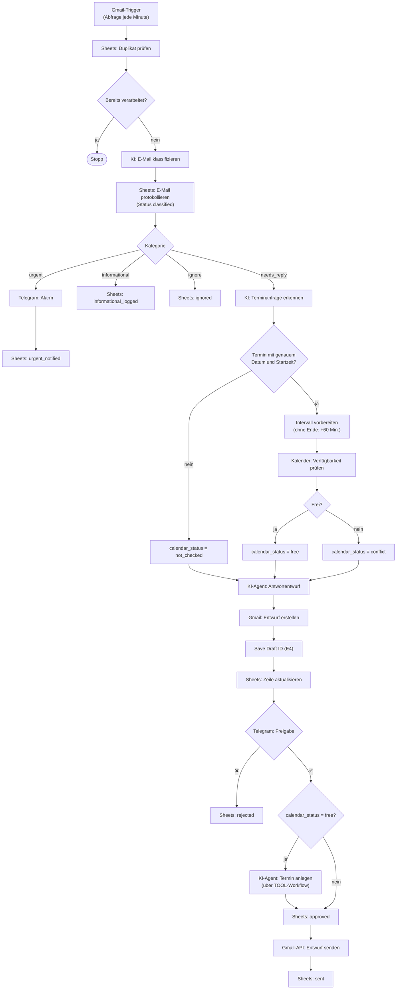

# Architektur

> **Eigenprojekt / Demo, kein Kundenauftrag.** Beschreibung der bereinigten Workflows in [`workflows/`](../workflows/). Stand: 21.11.2026.

## Ablauf

Grundsatz: Versand und Kalendereintrag liegen im Workflow nur auf dem ✅-Zweig der Telegram-Freigabe. Dass nur die eingetragene Person freigeben kann, ist konfiguriert (`approverIds`), aber nicht geprüft.

## Haupt-Workflow «📧GmailTriage» – alle 43 Nodes

| Abschnitt | Nodes |
|---|---|
| Eingang und Duplikate | `Gmail-New Email`, `Sheets - check duplicate`, `IF - Already Processed?` |
| Klassifikation und Protokoll | `AI - Classify Email`, `OpenAI Chat Model`, `Parser - Email Classificatuon`, `Sheets - Log New Email`, `Route - Email Category` |
| urgent | `Telegramm  - Urgent Alert`, `Set - Urgent Status`, `Sheets - Mark Urgent Notified` |
| informational | `Set — Informational Status`, `Sheets — Mark Informational` |
| ignore | `Set — Ignored Status`, `Sheets — Mark Ignored` |
| Terminerkennung und Kalender | `AI - Detect Meeting Request`, `OpenAI Chat Model2`, `Parser - Meeting Request`, `IF - Explicit Meeting Time?`, `Prepare Calendar Interval`, `Calendar — Check Availability`, `IF — Calendar Free?`, `Set — Calendar Free`, `Set — Calendar Conflict`, `Set — Calendar Not Checked` |
| Antwortentwurf | `AI Agent — Draft Reply`, `OpenAI Chat Model1`, `Gmail - Create Draft`, `Sheets — Save Draft ID`, `Update row in sheet` |
| Freigabe | `Telegram — Approval Request`, `IF — Approved?`, `Set — Rejected`, `Sheets — Mark Rejected` |
| Termin anlegen | `IF — Create Event?`, `AI Agent — Create Calendar Event`, `Calendar Event`, `Call '📅TOOL — Calendar Create Event'` |
| Versand | `Set — Approved`, `Sheets — Mark Approved`, `Gmail API — Send Approved Draft`, `Set — Sent Status`, `Sheets — Mark Sent` |

`OpenAI Chat Model`, `OpenAI Chat Model1`, `OpenAI Chat Model2` und `Calendar Event` sind Sprachmodell-Nodes (`gpt-5.4-mini`) der jeweiligen KI-Schritte.

## Sub-Workflow «📅TOOL — Calendar Create Event» – 3 Nodes

| Node | Aufgabe |
|---|---|
| `TRIGGER — Receive Event Data` | nimmt `title`, `start` und `end` vom Agenten entgegen |
| `GOOGLE CALENDAR — Create Event` | legt genau einen Termin im Kalender `primary` an |
| `SET — Return Event Result` | gibt `success`, `event_id`, `title`, `start`, `end` und `link` an den Agenten zurück |

## Bekannte Grenzen

E1–E5 und weitere Grenzen: Abschnitt **Status & Grenzen** im [README](../README.md).
